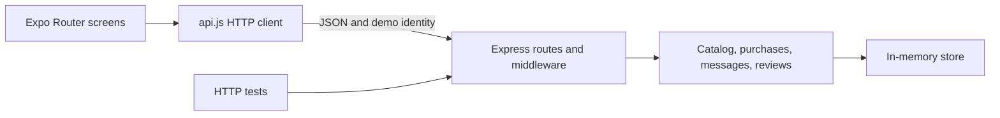
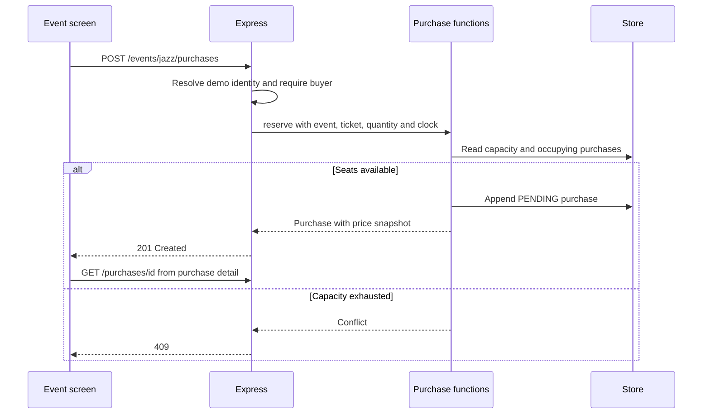
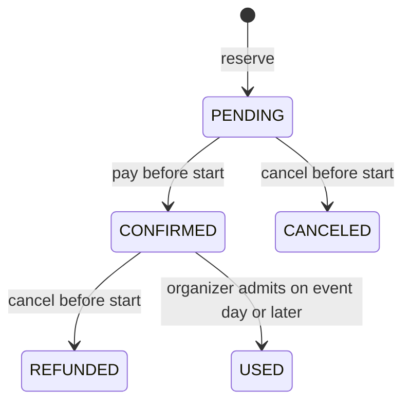

# AI Ticket It Architecture Walkthrough

AI Ticket It is a React Native client talking to a single Express process. The architectural center is the purchase: its state determines whether a ticket occupies capacity, whether the buyer can cancel, whether the organizer can admit the buyer, and whether a review can be written. Favorites are independent, while messages attach to a purchase and use its access rules.

**40-minute read and trace.** Spend 7 minutes on boundaries and data, 8 on the mobile request lifecycle, 12 on checkout and state changes, 8 on the other features, and 5 on the code-reading exercises. Keep the app open at [localhost:8081](http://localhost:8081) while you read. The guide and later quiz use commit [`1a91d1b`](https://github.com/ignaciospeicys/ai-ticket-it-utn-dds/commit/1a91d1bdd7ef6b0d663af0740663e16409681945).

# One application, two processes

The Expo process serves the client. Express serves JSON on port 3001 by default. On desktop web, both processes run on the Mac and can use loopback. On a physical phone, the API URL must point to the Mac’s LAN address because the phone’s localhost is the phone itself. The base URL is read from `EXPO_PUBLIC_API_URL` and falls back to `http://localhost:3001`. The host-bound API can accept LAN connections, and its web CORS policy allows HTTP origins on localhost and 127.0.0.1. [README.md](https://github.com/ignaciospeicys/ai-ticket-it-utn-dds/blob/1a91d1bdd7ef6b0d663af0740663e16409681945/README.md) · [mobile/src/api.js](https://github.com/ignaciospeicys/ai-ticket-it-utn-dds/blob/1a91d1bdd7ef6b0d663af0740663e16409681945/mobile/src/api.js) · [api/src/server.js](https://github.com/ignaciospeicys/ai-ticket-it-utn-dds/blob/1a91d1bdd7ef6b0d663af0740663e16409681945/api/src/server.js)

`server.js` only starts the process. `createApp({ store, clock })` wires Express and accepts a store and clock for tests. By default it creates a fresh store and reads wall-clock time for each request. Route handlers handle HTTP, call domain-oriented functions, and serialize responses. `catalog.js`, `purchases.js`, `messages.js` and `reviews.js` hold feature rules and operate on the same store. The server exposes the actual state. The client stores the active demo identity and screen state. [api/src/app.js](https://github.com/ignaciospeicys/ai-ticket-it-utn-dds/blob/1a91d1bdd7ef6b0d663af0740663e16409681945/api/src/app.js) · [api/src/store.js](https://github.com/ignaciospeicys/ai-ticket-it-utn-dds/blob/1a91d1bdd7ef6b0d663af0740663e16409681945/api/src/store.js)

# Records and ownership

The store holds arrays for users, events, purchases, messages and reviews, plus a map from buyer ID to a set of favorite event IDs. An event belongs to an organizer and embeds its ticket types. A purchase points to a buyer, an event and one ticket type within that event. The pair matters because the seed reuses the ticket ID `general` across events. A purchase copies the unit price in integer centavos and stores the quantity. Its total is computed when serialized. Messages and reviews point back to a purchase. A review also carries the event and organizer IDs, as well as the author name and event title used in the display. Restarting the API rebuilds the seed. [api/src/store.js](https://github.com/ignaciospeicys/ai-ticket-it-utn-dds/blob/1a91d1bdd7ef6b0d663af0740663e16409681945/api/src/store.js) · [api/src/purchases.js](https://github.com/ignaciospeicys/ai-ticket-it-utn-dds/blob/1a91d1bdd7ef6b0d663af0740663e16409681945/api/src/purchases.js) · [api/src/reviews.js](https://github.com/ignaciospeicys/ai-ticket-it-utn-dds/blob/1a91d1bdd7ef6b0d663af0740663e16409681945/api/src/reviews.js)

Four public reads are registered before the identity middleware, along with the health endpoint: demo users, categories, event list, and event detail. The middleware resolves `x-demo-user` against known users and rejects an unknown or missing identity with 401. `requireRole` checks buyer versus organizer, while `purchaseForParticipant` checks whether the user is the buyer or owns the event. Event sales separately checks event ownership. A valid organizer identity still gets 403 when it requests someone else’s sales. The identity header is suitable for a local demo, where callers can choose a seeded identity directly. Sofía and Estudio Sur appear in the UI. The third seeded identity, Escena Norte, is available to exercise ownership checks. [api/src/app.js](https://github.com/ignaciospeicys/ai-ticket-it-utn-dds/blob/1a91d1bdd7ef6b0d663af0740663e16409681945/api/src/app.js) · [api/src/http.js](https://github.com/ignaciospeicys/ai-ticket-it-utn-dds/blob/1a91d1bdd7ef6b0d663af0740663e16409681945/api/src/http.js) · [api/src/purchases.js](https://github.com/ignaciospeicys/ai-ticket-it-utn-dds/blob/1a91d1bdd7ef6b0d663af0740663e16409681945/api/src/purchases.js)

Expected failures are thrown as `HttpError` and returned as JSON with an `error` field. A malformed quantity gets 400, a missing event or ticket gets 404, and an operation conflicting with current capacity or state gets 409. Identity runs before the private route fallback, so an unauthenticated request to an unknown route can receive 401. [api/src/app.js](https://github.com/ignaciospeicys/ai-ticket-it-utn-dds/blob/1a91d1bdd7ef6b0d663af0740663e16409681945/api/src/app.js) · [api/src/http.js](https://github.com/ignaciospeicys/ai-ticket-it-utn-dds/blob/1a91d1bdd7ef6b0d663af0740663e16409681945/api/src/http.js)

# Navigation and server state

Files under `mobile/src/app` define routes. The root layout wraps the stack with a `SessionProvider`. Home checks `/health`, then loads selectable users. Selecting one stores the user in context and shows role-specific navigation. There is no durable identity across a full reload. Screens use `api()` for HTTP, which adds the demo header when a user is supplied, serializes request bodies, returns without parsing a 204 response, and throws for unsuccessful JSON responses. [mobile/src/app/_layout.jsx](https://github.com/ignaciospeicys/ai-ticket-it-utn-dds/blob/1a91d1bdd7ef6b0d663af0740663e16409681945/mobile/src/app/_layout.jsx) · [mobile/src/app/index.jsx](https://github.com/ignaciospeicys/ai-ticket-it-utn-dds/blob/1a91d1bdd7ef6b0d663af0740663e16409681945/mobile/src/app/index.jsx) · [mobile/src/session.jsx](https://github.com/ignaciospeicys/ai-ticket-it-utn-dds/blob/1a91d1bdd7ef6b0d663af0740663e16409681945/mobile/src/session.jsx) · [mobile/src/api.js](https://github.com/ignaciospeicys/ai-ticket-it-utn-dds/blob/1a91d1bdd7ef6b0d663af0740663e16409681945/mobile/src/api.js)

`useResource(path, user)` binds reads to screen focus. A path change, identity change or explicit `reload()` can trigger another read. Reload increments a revision. A result is shown only when its path, user and revision match, and cleanup ignores responses from effects that have lost focus or been replaced. The fetch itself continues. Most mutations use a local busy flag and call `reload()` on success. Reservation is a useful exception because success navigates to the new purchase detail, which fetches that resource. This pattern keeps the backend authoritative and avoids a separate global cache. [mobile/src/useResource.js](https://github.com/ignaciospeicys/ai-ticket-it-utn-dds/blob/1a91d1bdd7ef6b0d663af0740663e16409681945/mobile/src/useResource.js) · [mobile/src/app/events/[id].jsx](https://github.com/ignaciospeicys/ai-ticket-it-utn-dds/blob/1a91d1bdd7ef6b0d663af0740663e16409681945/mobile/src/app/events/%5Bid%5D.jsx) · [mobile/src/app/purchases/[id].jsx](https://github.com/ignaciospeicys/ai-ticket-it-utn-dds/blob/1a91d1bdd7ef6b0d663af0740663e16409681945/mobile/src/app/purchases/%5Bid%5D.jsx)

# Follow the last available ticket

Open **Jazz en el patio** as Sofía. Its General ticket has a capacity of one. Event detail returns the organizer and review display data, computed ticket availability, and a `salesOpen` flag based on server time. The screen lets Sofía choose a ticket and quantity and calculates an indicative total. It posts the ticket ID and quantity, while Express uses the route’s event ID and the buyer identity resolved from the header. The price used for the purchase comes from the server’s current ticket record. [mobile/src/app/events/[id].jsx](https://github.com/ignaciospeicys/ai-ticket-it-utn-dds/blob/1a91d1bdd7ef6b0d663af0740663e16409681945/mobile/src/app/events/%5Bid%5D.jsx) · [api/src/app.js](https://github.com/ignaciospeicys/ai-ticket-it-utn-dds/blob/1a91d1bdd7ef6b0d663af0740663e16409681945/api/src/app.js)

`reserve` rejects a closed sale, invalid quantity, unknown ticket type or insufficient capacity. `availability` derives how many places are used from purchases for that event whose status is `PENDING`, `CONFIRMED` or `USED`, grouped by ticket type. It subtracts those totals from the configured capacities. The validation and append are synchronous in one Node process. Two requests arriving together still execute their checks and mutations one after the other. This guarantee depends on a single process with one store, and would need a different mechanism across replicas. [api/src/purchases.js](https://github.com/ignaciospeicys/ai-ticket-it-utn-dds/blob/1a91d1bdd7ef6b0d663af0740663e16409681945/api/src/purchases.js) · [api/test/purchases.test.js](https://github.com/ignaciospeicys/ai-ticket-it-utn-dds/blob/1a91d1bdd7ef6b0d663af0740663e16409681945/api/test/purchases.test.js)

# The purchase lifecycle and the clock

Payment is simulated. For a pending purchase before the sale closes, `pay` changes the state to confirmed. The buyer can cancel a pending purchase before the start time, producing `CANCELED`. Canceling a confirmed purchase before the start time produces `REFUNDED`. Both states remain in the history and stop counting toward availability. There is no separate stock compensating write. A second cancellation fails the state guard and cannot return extra capacity. Pending reservations have no expiry job. [api/src/purchases.js](https://github.com/ignaciospeicys/ai-ticket-it-utn-dds/blob/1a91d1bdd7ef6b0d663af0740663e16409681945/api/src/purchases.js) · [api/test/transitions.test.js](https://github.com/ignaciospeicys/ai-ticket-it-utn-dds/blob/1a91d1bdd7ef6b0d663af0740663e16409681945/api/test/transitions.test.js)

Only the event’s organizer can mark a confirmed purchase as used. `canUse` allows that from the day of the event in Buenos Aires, including before its start time on that day, and later. A used ticket still occupies capacity. Sales, payment and cancellation compare against the start timestamp. For confirmed purchases, the display count is the nonnegative ceiling of the remaining milliseconds divided by 24 hours. It is an elapsed-time count, so a short interval across midnight still shows one. [api/src/purchases.js](https://github.com/ignaciospeicys/ai-ticket-it-utn-dds/blob/1a91d1bdd7ef6b0d663af0740663e16409681945/api/src/purchases.js) · [mobile/src/app/sales/[id].jsx](https://github.com/ignaciospeicys/ai-ticket-it-utn-dds/blob/1a91d1bdd7ef6b0d663af0740663e16409681945/mobile/src/app/sales/%5Bid%5D.jsx)

# Catalog, favorites and event publishing

`GET /events` filters to events whose start is at or after the server clock. Text search matches a case-folded substring across title and description; the category filter is an exact match. The route can sort by start date, minimum ticket price, or organizer rating, with ID used for ties. Categories are derived from all stored events, so a category can appear even when it has no upcoming matches. Direct event detail also serves past events. A favorite is a set membership, so repeated PUTs keep one favorite and removing an absent membership succeeds. Favorites can keep past events. [api/src/app.js](https://github.com/ignaciospeicys/ai-ticket-it-utn-dds/blob/1a91d1bdd7ef6b0d663af0740663e16409681945/api/src/app.js) · [api/src/catalog.js](https://github.com/ignaciospeicys/ai-ticket-it-utn-dds/blob/1a91d1bdd7ef6b0d663af0740663e16409681945/api/src/catalog.js) · [mobile/src/app/catalog.jsx](https://github.com/ignaciospeicys/ai-ticket-it-utn-dds/blob/1a91d1bdd7ef6b0d663af0740663e16409681945/mobile/src/app/catalog.jsx) · [api/test/catalog.test.js](https://github.com/ignaciospeicys/ai-ticket-it-utn-dds/blob/1a91d1bdd7ef6b0d663af0740663e16409681945/api/test/catalog.test.js)

The organizer form converts a local date and time into an ISO timestamp and pesos into integer centavos. The server validates a future date, text fields, a bounded list of ticket types, unique names without regard to case, nonnegative integer prices, positive integer capacities, and an optional HTTPS image URL. The organizer ID comes from the request identity. Organizer views fetch that account’s events and sales, while buyers can find an upcoming published event in the catalog. [mobile/src/app/new-event.jsx](https://github.com/ignaciospeicys/ai-ticket-it-utn-dds/blob/1a91d1bdd7ef6b0d663af0740663e16409681945/mobile/src/app/new-event.jsx) · [api/src/catalog.js](https://github.com/ignaciospeicys/ai-ticket-it-utn-dds/blob/1a91d1bdd7ef6b0d663af0740663e16409681945/api/src/catalog.js) · [api/src/purchases.js](https://github.com/ignaciospeicys/ai-ticket-it-utn-dds/blob/1a91d1bdd7ef6b0d663af0740663e16409681945/api/src/purchases.js)

# Messages and reviews

Chat is scoped to a purchase. Both GET and POST call `purchaseForParticipant`. On send, the server supplies author and time, trims the text and caps its length at 1,000 characters. The screen reloads on send or focus and offers a refresh action. This is request-driven messaging. The tests show both participants can write and a third identity gets 403. [api/src/messages.js](https://github.com/ignaciospeicys/ai-ticket-it-utn-dds/blob/1a91d1bdd7ef6b0d663af0740663e16409681945/api/src/messages.js) · [mobile/src/app/messages/[id].jsx](https://github.com/ignaciospeicys/ai-ticket-it-utn-dds/blob/1a91d1bdd7ef6b0d663af0740663e16409681945/mobile/src/app/messages/%5Bid%5D.jsx) · [api/test/messages.test.js](https://github.com/ignaciospeicys/ai-ticket-it-utn-dds/blob/1a91d1bdd7ef6b0d663af0740663e16409681945/api/test/messages.test.js)

Reviews require a buyer-owned purchase in `USED` state, an event whose start time has passed, and no existing review for that purchase. The model stores a start time, so the eligibility check uses that timestamp as its cutoff. Ratings are integers from 1 through 5 and a non-blank comment is required. The event detail lists reviews from the same organizer’s events that started before both the viewed event and the current time. The organizer’s rating is a separate average over all that organizer’s stored reviews and drives catalog sorting. The seed’s used purchase makes the review flow easy to try. [api/src/reviews.js](https://github.com/ignaciospeicys/ai-ticket-it-utn-dds/blob/1a91d1bdd7ef6b0d663af0740663e16409681945/api/src/reviews.js) · [api/src/catalog.js](https://github.com/ignaciospeicys/ai-ticket-it-utn-dds/blob/1a91d1bdd7ef6b0d663af0740663e16409681945/api/src/catalog.js) · [mobile/src/reviewForm.jsx](https://github.com/ignaciospeicys/ai-ticket-it-utn-dds/blob/1a91d1bdd7ef6b0d663af0740663e16409681945/mobile/src/reviewForm.jsx) · [api/test/reviews.test.js](https://github.com/ignaciospeicys/ai-ticket-it-utn-dds/blob/1a91d1bdd7ef6b0d663af0740663e16409681945/api/test/reviews.test.js)

# Five minutes of code tracing

1. Open the event detail screen and find the call that submits a reservation. Follow the same request through the client wrapper, Express route and purchase function. Note which inputs are trusted and which are reconstructed by the server.
2. Reserve and pay for the General ticket. Cancel it, switch to Estudio Sur, and find the purchase in the event’s sales. Use the code to explain how the same record can show a refund and make a place available again.
3. Read the parallel-reservation, transition and ownership tests. Trace what each assertion proves and identify which facts depend on the injected clock or seed data. The tests use real HTTP against a fresh Express instance on an ephemeral loopback port. [api/support/http-test.js](https://github.com/ignaciospeicys/ai-ticket-it-utn-dds/blob/1a91d1bdd7ef6b0d663af0740663e16409681945/api/support/http-test.js) · [api/test/purchases.test.js](https://github.com/ignaciospeicys/ai-ticket-it-utn-dds/blob/1a91d1bdd7ef6b0d663af0740663e16409681945/api/test/purchases.test.js) · [api/test/transitions.test.js](https://github.com/ignaciospeicys/ai-ticket-it-utn-dds/blob/1a91d1bdd7ef6b0d663af0740663e16409681945/api/test/transitions.test.js)

When you ask for the quiz, it will use this commit. Each question will specify relevant inputs such as identity, initial purchase state and time boundary. Answers will be graded against the route, domain function and test evidence where applicable.
